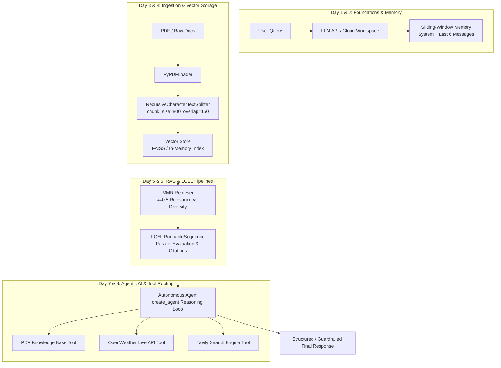

# 8-Day Applied Generative AI & Agentic Systems Bootcamp

A production-oriented GenAI engineering portfolio built with **LangChain**, **Google Gemini**, **Groq**, **FAISS**, **Pydantic**, and **Tavily**. This repository documents an 8-day progressive curriculum covering LLM foundations, conversational memory optimization, document ingestion, vector retrieval (RAG with MMR), LCEL pipelines, and autonomous multi-tool AI agents.

---

## System Architecture

